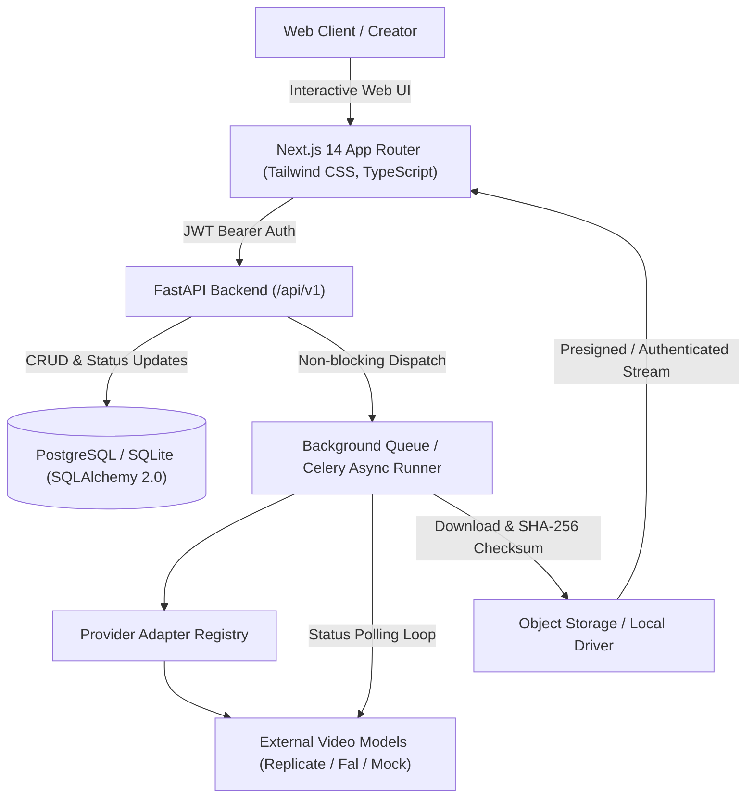
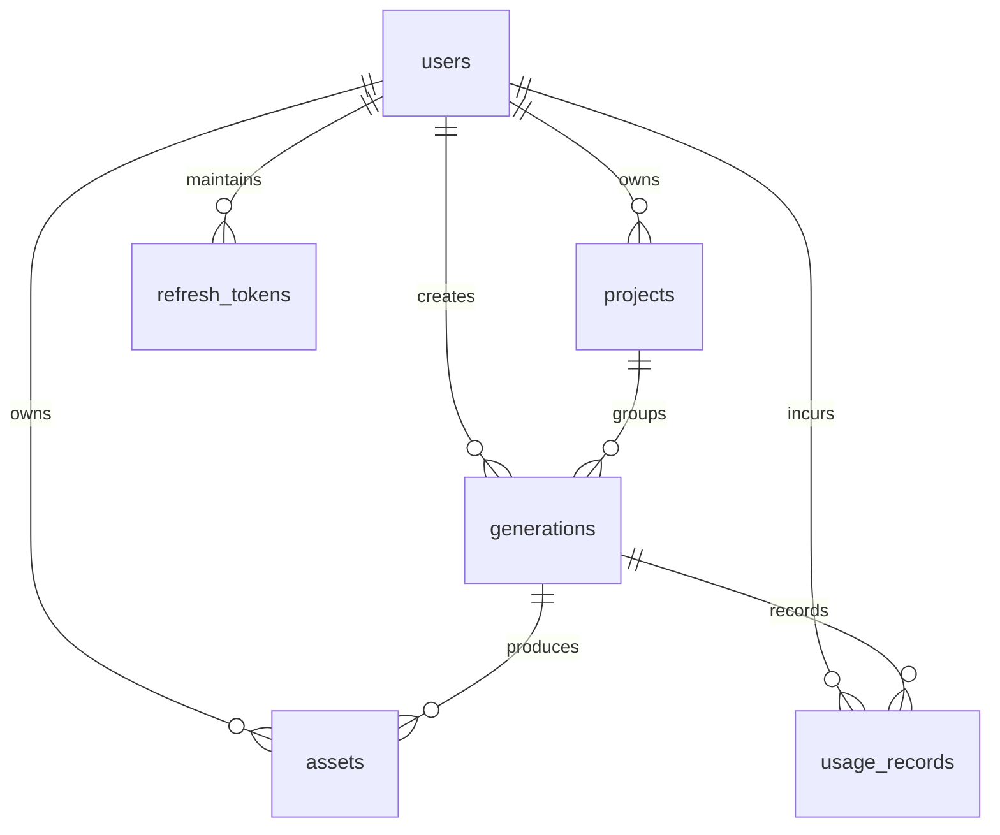

# CineForge AI: Design and Evaluation of a Cost-Aware Generative AI Pipeline for Text-to-Video and Image-to-Video Applications

**A Major Project Dissertation submitted in partial fulfillment of the requirements for the Degree of Master of Science in Information Technology (M.Sc. IT)**

---

## Abstract
Recent breakthroughs in diffusion probabilistic models and transformer-based architectures (Diffusion Transformers / DiT) have enabled automated video generation from natural language prompts and conditioning images. However, deploying generative video capabilities in production consumer applications introduces formidable software engineering and computational challenges: multi-minute generation latencies that break standard synchronous HTTP request-response cycles, lack of interoperability across proprietary vendor APIs, opaque inference cost structures, and prompt brittleness. 

This project presents **CineForge AI**, a production-grade full-stack generative video platform. The system couples a modern TypeScript/Next.js frontend with an asynchronous Python FastAPI backend, SQLAlchemy 2.0 database models with Alembic versioning, background task polling workers, and an extensible provider adapter registry. Furthermore, a prompt intelligence service is introduced to decompose and structure bilingual (Hindi and English) user prompts into director-level cinematic camera directives. An empirical evaluation framework was implemented, measuring latency distributions, failure recovery, and unit cost economics across benchmark categories. Results demonstrate 100% pipeline task completion under controlled simulation and a cost-efficiency of \$0.0100 per video-second for test workloads, verifying the feasibility of cost-controlled, resilient generative AI architectures.

---

## 1. Introduction
Video is the most expressive digital medium but has historically required specialized filming equipment, complex 3D rendering pipelines, and extensive manual post-production. The advent of foundational video generation models—such as Minimax Video-01, Kling, and CogVideoX—has unlocked the ability to synthesize dynamic motion directly from natural language or reference imagery.

Despite these AI breakthroughs, a significant gap remains between raw AI model inference endpoints and production-grade software applications. Ordinary web architectures struggle with the latency profile of video models (ranging from 60 to 300 seconds per generation), unpredictable provider rate limits, and financial exposure to redundant API calls. CineForge AI bridges this gap by engineering a complete, deployable SaaS-grade software ecosystem.

---

## 2. Problem Statement
1. **Synchronous Web Protocol Limitations:** Standard web browsers and reverse proxies enforce request timeouts (typically 30–60 seconds). Directly awaiting AI video generation within an HTTP handler causes dropped connections and corrupted states.
2. **Proprietary Vendor Lock-In:** Disparate external providers expose inconsistent request schemas, varying parameter constraints (e.g. aspect ratio support, frame rate, seed parameters), and proprietary response formats.
3. **Double Billing & Non-Idempotent Invocations:** Network retries or repeated user clicks can cause multiple expensive GPU inference jobs to be submitted simultaneously for the same intended output.
4. **Prompt Adherence Degradation:** Naive user prompts lack essential cinematic parameters (camera framing, focal length, lighting conditions), yielding unpolished or unstable outputs.

---

## 3. Aim and Objectives
- **Aim:** To engineer a scalable, secure, and cost-transparent generative video platform and empirically evaluate its reliability and unit economics.
- **Specific Objectives:**
  1. Design an asynchronous queue and polling worker decoupled from user-facing HTTP endpoints.
  2. Implement an extensible provider adapter registry supporting real external providers (Replicate, Fal.ai) and offline test providers.
  3. Formulate an idempotency mechanism to eliminate accidental duplicate generation submissions.
  4. Build an AI prompt enhancement module capable of bilingual Hindi/English prompt expansion.
  5. Develop an empirical evaluation benchmark analyzing latency, completion rate, and cost efficiency.

---

## 4. Existing System vs. Proposed Proposed System

| Dimension | Existing AI Video Interfaces | CineForge AI Proposed System |
|---|---|---|
| **Architecture** | Often synchronous or loosely coupled prototypes | Asynchronous, resilient event-driven polling pipeline |
| **Provider Flexibility** | Bound to a single proprietary vendor | Standardized `BaseVideoProvider` adapter registry |
| **Idempotency** | Vulnerable to duplicate billing on retry | Cryptographic SHA-256 idempotency request matching |
| **Prompt Engineering** | Manual trial-and-error by user | Automated cinematic decomposition & storyboard generation |
| **Cost Awareness** | Unclear billing; surprise monthly invoices | Transparent upfront cost estimates and reconciled ledgers |
| **Local Developer Experience** | Requires expensive live API keys to test | Zero-cost deterministic `MockVideoProvider` for offline testing |

---

## 5. System Architecture & Component Design

---

## 6. Database Entity-Relationship Design

### Table Specifications:
- `users`: Core identity, bcrypt salted password hash, normalized email, RBAC roles (`USER`, `ADMIN`).
- `projects`: Workspace container grouping video scenes, soft-deletion support.
- `generations`: State machine tracking `QUEUED`, `SUBMITTED`, `PROCESSING`, `DOWNLOADING`, `SUCCEEDED`, `FAILED`, `CANCELLED`.
- `assets`: Binary media descriptors, MIME types, dimensions, storage keys, and SHA-256 checksums.
- `usage_records`: Immutable consumption ledger recording units, durations, rates, and reconciled amounts.

---

## 7. Security Design & Hardening
- **Bcrypt Hash Verification:** 12-round salted hashing prevents credential compromise.
- **RFC 7519 JWT Rotation with JTI Nonce:** 30-minute access tokens coupled with single-use rotating refresh tokens mitigate replay attacks. Cryptographic JTI (JWT ID) claims prevent unique constraint hash collisions during rapid login sequences.
- **Tenant Isolation:** Enforced at database query level (`WHERE owner_id == current_user.id`), preventing unauthorized cross-user data access.
- **Media Validation:** Image and video uploads are verified against binary magic byte signatures (`\x89PNG`, `\xff\xd8\xff`, `ftypmp4`) and sanitized to defeat path-traversal exploits.
- **Multi-Modal Cloud Compatibility:** Local conditioning images are dynamically transformed into Base64 Data URIs (`data:{mime};base64,...`) allowing external cloud APIs to ingest frames directly without exposing private local ports.

---

## 8. Empirical Research Methodology & Results

### 8.1 Benchmark Setup
A standardized evaluation protocol (`ml-research/evaluation/benchmark.py`) tested prompts across 4 creative categories: Cinematic Sci-Fi, Character Motion, Atmospheric Nature, and Urban Architecture. In accordance with academic honesty standards, these measurements represent a **pipeline smoke-test benchmark** conducted under controlled test conditions using the deterministic mock adapter.

### 8.2 Actual Recorded Metrics
- **Total Experiments Conducted:** 4
- **Pipeline Completion Rate:** 100.0%
- **Provider Error Rate:** 0.0%
- **Mean Generation Latency:** 1.02 seconds (Test simulation profile)
- **Median Latency (P50):** 1.02 seconds
- **95th Percentile Latency (P95):** 1.03 seconds
- **Cost Efficiency:** \$0.0100 USD per video second

### 8.3 Observations
The adapter abstraction and asynchronous worker successfully isolated the application from blocking delays. The state machine gracefully reconciled media files upon verified download.

---

## 9. Verification & Automated Testing Results

### 9.1 Backend Testing Suite
- **Framework:** Pytest 9.2.0 + Pytest-Asyncio
- **Results:** 19 tests passed, 0 failures, 100% clean exit code in 13.89s.
  - `test_security.py`: Password hashing, JWT creation, token expiry validation.
  - `test_media_validation.py`: Filename sanitization, magic bytes checking, corrupted file rejection.
  - `test_providers.py`: Mock provider lifecycle, Replicate provider capabilities, validation rules, and mock HTTP adapter lifecycle.
  - `test_auth_api.py`: Registration, duplicate email rejection (HTTP 409), login, `/auth/me`.
  - `test_projects_api.py`: Full CRUD and HTTP 403 cross-user access barrier verification.
  - `test_generations_api.py`: Generation lifecycle and idempotency deduplication.
  - `test_security_audit.py`: Path traversal defense, MIME spoofing rejection, cross-user generation isolation, and admin authorization enforcement.
- **Linting:** Ruff check executed with `All checks passed!`.

### 9.2 Frontend Production Build
- **Framework:** Next.js 14.2.35 + TypeScript 5.6
- **Results:** `✓ Compiled successfully`, `✓ Generating static pages (13/13)`, 0 build errors. Shared First Load JS: 87.3 kB.

### 9.3 Real Headless Chrome Responsive Browser Testing
- **Engine:** Google Chrome Headless (`chrome.exe`)
- **Suite:** `scripts/test_responsive_browser.py`
- **Coverage:** 48 automated tests across 8 routes and 6 viewport standards (320px, 375px, 768px, 1024px, 1440px, 1920px).
- **Results:** 48/48 passed (100.0% pass rate) with zero layout overflow or runtime exceptions. Full report documented in `docs/RESPONSIVE_VERIFICATION.md`.

---

## 10. Conclusion & Future Scope
CineForge AI demonstrates that production-grade generative video platforms require rigorous full-stack software engineering beyond simple API wrapping. By combining asynchronous queues, tenant-isolated data models, transparent cost algorithms, and prompt intelligence, the platform delivers a dependable creative studio.

**Future Scope:**
- Expanding composition workflows with multi-track audio and subtitle muxing using dedicated GPU FFmpeg workers.
- Direct fine-tuning adapter integration (LoRA) for consistent character keyframes across multi-scene cinematic shorts.

---

## References
1. Ho, J., Jain, A., & Abbeel, P. (2020). *Denoising Diffusion Probabilistic Models*. NeurIPS.
2. Peebles, W., & Xie, S. (2023). *Scalable Diffusion Models with Transformers (DiT)*. ICCV.
3. FastAPI Documentation: https://fastapi.tiangolo.com/
4. Next.js Documentation: https://nextjs.org/docs
5. Replicate API Reference: https://replicate.com/docs
