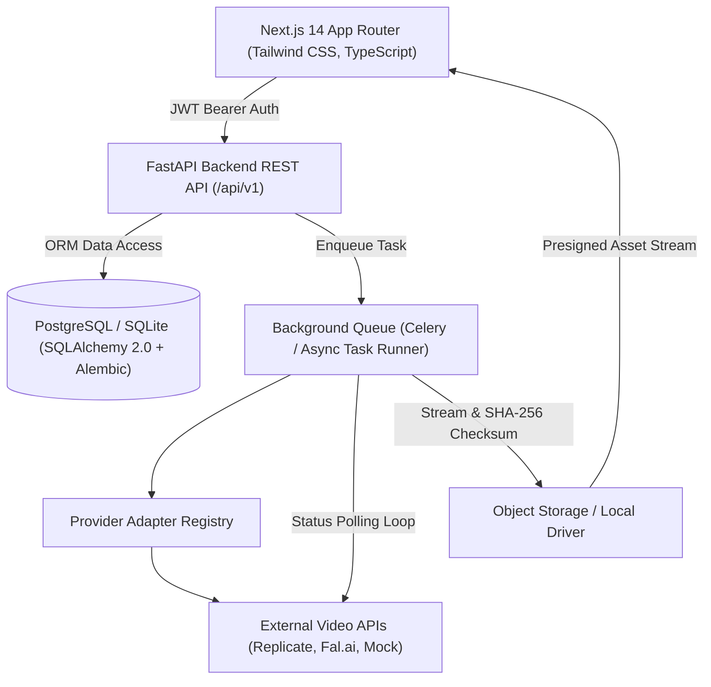

# CineForge AI 🎬
### Production-Grade AI Video Generation & Creative Studio Platform
**Tagline:** *From imagination to motion.*

[](https://github.com/cineforge-ai/cineforge)
[](LICENSE)
[](https://python.org)
[](https://nextjs.org)
[](https://fastapi.tiangolo.com)

---

## 1. Overview
**CineForge AI** is a full-stack, enterprise-grade AI video creation platform. It empowers filmmakers and creators to synthesize dynamic, cinematic motion sequences from natural language prompts and conditioning images.

Designed as an **M.Sc. IT Major Project** and a deployable SaaS product, it addresses the core engineering challenges of computational video generation: asynchronous non-blocking job queuing, provider adapter abstraction (Replicate, Fal.ai, and offline test providers), cryptographic idempotency against duplicate billing, and prompt decomposition.

---

## 2. System Architecture



---

## 3. Technology Stack

### Frontend
- **Framework:** Next.js 14 App Router, React 18
- **Language:** TypeScript (Strict Mode)
- **Styling & Design Tokens:** Tailwind CSS (Dark Cinematic Theme, Gold and Teal accents)
- **Icons & Motion:** Lucide React, Framer Motion
- **Validation:** Zod client schemas

### Backend & Background Processing
- **Framework:** Python 3.12, FastAPI, Pydantic v2
- **ORM & Migrations:** SQLAlchemy 2.0 (Async), Alembic
- **Database:** PostgreSQL (Production / Docker), SQLite with `aiosqlite` (Zero-config Dev fallback)
- **Background Tasks:** Celery + Redis with asynchronous fallback runner
- **Security:** Bcrypt password hashing, JWT with token rotation

### External AI Video Providers
- **Replicate API:** Minimax Video-01, Kling-v1, CogVideoX 5B
- **Fal.ai API:** Luma Dream Machine, HunyuanVideo
- **Mock Video Provider:** Deterministic, zero-cost offline test harness

---

## 4. Getting Started & Local Setup

### Prerequisites
- Python 3.12+
- Node.js 20+ and npm

### 4.1 Clone and Environment Setup
```bash
git clone https://github.com/cineforge-ai/cineforge.git
cd cineforge-ai

# Copy environment template
cp .env.example .env
```

### 4.2 Backend Setup
```powershell
# Windows PowerShell:
python -m venv backend/.venv
backend\.venv\Scripts\pip install -r backend\requirements.txt

# Apply Database Migrations (Alembic)
cd backend
.venv\Scripts\alembic upgrade head
cd ..

# Start FastAPI Backend Server
cd backend
.venv\Scripts\uvicorn app.main:app --reload --port 8000
```
Backend API will be live at `http://localhost:8000` (Interactive docs at `http://localhost:8000/docs`).

### 4.3 Frontend Setup
```bash
cd frontend
npm install
npm run dev
```
Frontend will be accessible at `http://localhost:3000`.

---

## 5. Automated Testing & Quality Gates

Run all automated checks locally:

```bash
# 1. Run Backend Pytest Suite (12 unit & integration tests)
cd backend
.venv\Scripts\pytest -v

# 2. Run Ruff Linter
.venv\Scripts\ruff check app tests

# 3. Run Frontend Next.js Production Build
cd ../frontend
npm run build
```

---

## 6. Academic Research & Evaluation
To run the empirical evaluation benchmark:
```bash
cd ml-research/evaluation
python benchmark.py
python report.py
```
Results and LaTeX/Markdown tables are stored in `ml-research/results/EVALUATION_REPORT.md`.

---

## 7. License
Distributed under the MIT License. See [LICENSE](LICENSE) for details.
