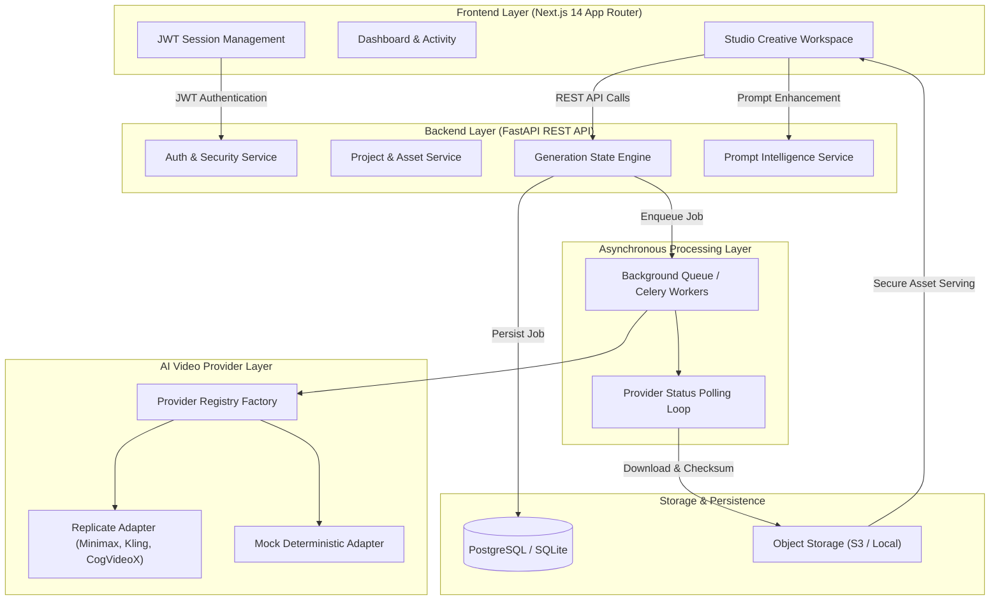

# CineForge AI — Architectural Specification

## 1. System Overview
**CineForge AI** is a production-style, multi-model generative AI platform designed for high-fidelity video synthesis, prompt intelligence, and scene planning.

---

## 2. Key Modules & Separation of Concerns

### 2.1 Backend API Layer (`backend/app/api/v1/`)
- **FastAPI Framework:** High-performance asynchronous REST endpoints with automated OpenAPI schemas (`/docs`).
- **Dependencies (`dependencies.py`):** Centralized JWT bearer authentication, role enforcement (`USER`, `ADMIN`, `SYSTEM_WORKER`), and scoped database session handling.

### 2.2 Domain Services (`backend/app/services/`)
- `auth_service.py`: Password hashing with Bcrypt, token rotation, and audit logging.
- `project_service.py`: Multi-tenant project workspace CRUD with strict user isolation.
- `generation_service.py`: Core state machine tracking `QUEUED` -> `SUBMITTED` -> `PROCESSING` -> `DOWNLOADING` -> `SUCCEEDED` / `FAILED`. Idempotency key checking prevents duplicate billing.
- `asset_service.py`: File signature validation, SHA-256 checksumming, and storage management.
- `prompt_service.py`: Bilingual Hindi & English cinematic prompt decomposition.

### 2.3 Provider Abstraction (`backend/app/providers/`)
- Unified `BaseVideoProvider` interface decouples core logic from proprietary vendor APIs.
- Concrete adapters for Replicate and Fal.ai handle payload mapping, polling, and video streaming.
- `MockVideoProvider` provides zero-cost, deterministic local and CI verification.

### 2.4 Asynchronous Worker System (`backend/app/workers/`)
- Long-running inference jobs do not block standard web requests.
- Decoupled worker handles polling loops, status updates, and download streaming.
