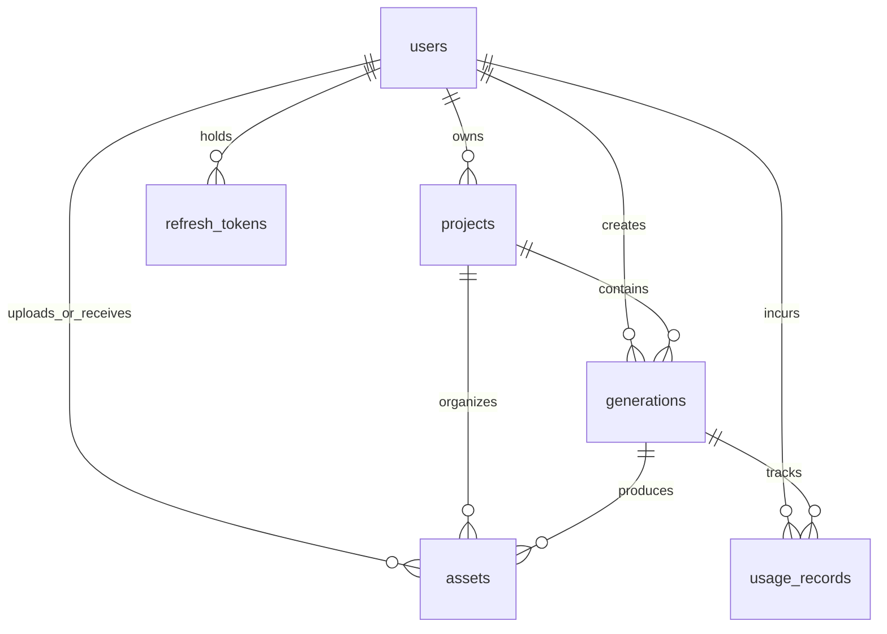

# CineForge AI — Database Schema Documentation

## 1. Overview
CineForge AI uses PostgreSQL in production environments and provides full local SQLite compatibility during development and testing. Database migrations are versioned with **Alembic**.

---

## 2. Table Specifications

### 2.1 `users`
Stores user identities, credentials, and roles.
- `id` (VARCHAR(36), PK): UUID primary key.
- `email` (VARCHAR(255), UNIQUE, INDEX): Normalized unique email.
- `password_hash` (VARCHAR(255)): Bcrypt salted hash.
- `display_name` (VARCHAR(100)): User chosen display name.
- `role` (VARCHAR(30)): Role-based access control: `USER`, `ADMIN`, `SYSTEM_WORKER`.
- `is_active` (BOOLEAN): Soft-disable flag.
- `email_verified_at` (TIMESTAMP NULL): Email verification timestamp.
- `created_at` (TIMESTAMP): Record creation timestamp (UTC).
- `updated_at` (TIMESTAMP): Last update timestamp (UTC).

### 2.2 `refresh_tokens`
Manages token rotation and revocation.
- `id` (VARCHAR(36), PK): UUID.
- `user_id` (VARCHAR(36), FK `users.id` ON DELETE CASCADE, INDEX).
- `token_hash` (VARCHAR(255), UNIQUE, INDEX): SHA-256 hash of refresh token.
- `expires_at` (TIMESTAMP): Expiry timestamp.
- `is_revoked` (BOOLEAN): Revocation status.
- `created_at` (TIMESTAMP).

### 2.3 `projects`
Organizes video creation workspaces.
- `id` (VARCHAR(36), PK): UUID.
- `owner_id` (VARCHAR(36), FK `users.id` ON DELETE CASCADE, INDEX).
- `title` (VARCHAR(200)): Project name.
- `description` (TEXT NULL): Project notes or synopsis.
- `status` (VARCHAR(30)): `ACTIVE` or `ARCHIVED`.
- `metadata_json` (JSON NULL): Storyboard notes, genre, tags.
- `created_at`, `updated_at` (TIMESTAMP).
- `deleted_at` (TIMESTAMP NULL): Soft deletion timestamp.

### 2.4 `generations`
Core state machine tracking video synthesis jobs.
- `id` (VARCHAR(36), PK): UUID.
- `project_id` (VARCHAR(36), FK `projects.id` ON DELETE CASCADE, INDEX).
- `owner_id` (VARCHAR(36), FK `users.id` ON DELETE CASCADE, INDEX).
- `provider_name` (VARCHAR(50), INDEX): e.g. `replicate`, `fal`, `mock`.
- `provider_model_id` (VARCHAR(100)): e.g. `kling-v1`, `luma-dream-machine`.
- `generation_type` (VARCHAR(30)): `text_to_video` or `image_to_video`.
- `prompt` (TEXT): Prompt text.
- `negative_prompt` (TEXT NULL): Negative prompt text.
- `input_asset_id` (VARCHAR(36) NULL): FK to input image asset for image-to-video.
- `parameters_json` (JSON): Aspect ratio, duration, resolution, fps, seed.
- `status` (VARCHAR(30), INDEX): `QUEUED`, `SUBMITTED`, `PROCESSING`, `DOWNLOADING`, `SUCCEEDED`, `FAILED`, `CANCELLED`.
- `provider_job_id` (VARCHAR(255) NULL, INDEX): External provider task ID.
- `progress_percent` (INTEGER NULL): 0-100 completion progress.
- `idempotency_key` (VARCHAR(100), UNIQUE, INDEX): Prevents duplicate billing/generation.
- `estimated_cost` (FLOAT): Upfront catalog price estimate.
- `actual_cost` (FLOAT NULL): Reconciled charge.
- `error_code` (VARCHAR(50) NULL).
- `safe_error_message` (TEXT NULL): User-safe sanitized error message.
- `queued_at`, `started_at`, `completed_at`, `created_at`, `updated_at` (TIMESTAMP).

### 2.5 `assets`
Stores metadata and pointers for images, videos, thumbnails, and audio.
- `id` (VARCHAR(36), PK): UUID.
- `owner_id` (VARCHAR(36), FK `users.id` ON DELETE CASCADE, INDEX).
- `project_id` (VARCHAR(36) NULL, FK `projects.id`, INDEX).
- `generation_id` (VARCHAR(36) NULL, FK `generations.id`, INDEX).
- `asset_type` (VARCHAR(50)): `input_image`, `generated_video`, `thumbnail`, `audio`.
- `storage_key` (VARCHAR(500)): Relative path or S3 key.
- `original_filename` (VARCHAR(255)).
- `mime_type` (VARCHAR(100)).
- `file_size_bytes` (INTEGER).
- `checksum` (VARCHAR(64)): SHA-256 hash.
- `width`, `height` (INTEGER NULL).
- `duration_seconds` (FLOAT NULL).
- `created_at` (TIMESTAMP).
- `deleted_at` (TIMESTAMP NULL).

### 2.6 `usage_records`
Audit trail of resource consumption and billing reconciliation.
- `id` (VARCHAR(36), PK): UUID.
- `owner_id` (VARCHAR(36), FK `users.id` ON DELETE CASCADE, INDEX).
- `generation_id` (VARCHAR(36) NULL, FK `generations.id`, INDEX).
- `provider_name` (VARCHAR(50)).
- `model_id` (VARCHAR(100)).
- `usage_type` (VARCHAR(50)): `video_seconds`, `llm_tokens`, etc.
- `units` (FLOAT): Quantity consumed.
- `estimated_amount` (FLOAT).
- `actual_amount` (FLOAT NULL).
- `currency` (VARCHAR(10)): `USD`.
- `pricing_source` (VARCHAR(100)).
- `recorded_at` (TIMESTAMP).

### 2.7 `audit_logs`
Security compliance and sensitive operation event trail.
- `id` (VARCHAR(36), PK): UUID.
- `actor_user_id` (VARCHAR(36) NULL, INDEX).
- `action` (VARCHAR(100), INDEX): `USER_REGISTER`, `USER_LOGIN`, `GENERATION_CANCEL`, etc.
- `resource_type` (VARCHAR(50)).
- `resource_id` (VARCHAR(36) NULL).
- `request_id` (VARCHAR(50) NULL).
- `sanitized_metadata` (JSON NULL).
- `created_at` (TIMESTAMP).

### 2.8 `provider_configs`
Configured provider capabilities and dynamic flags.
- `id` (VARCHAR(36), PK): UUID.
- `provider_name` (VARCHAR(50), UNIQUE, INDEX).
- `is_enabled` (BOOLEAN).
- `capabilities_json` (JSON).
- `supported_models_json` (JSON).
- `updated_at` (TIMESTAMP).
