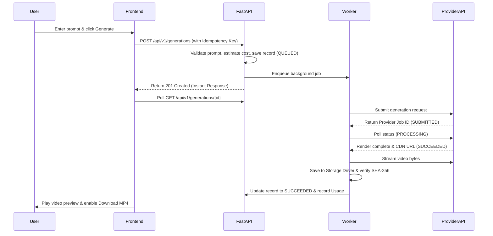

# CineForge AI — Master Academic Viva & Examination Guide
### Comprehensive M.Sc. IT Project Oral Examination Preparation

---

### Q1: What is CineForge AI and what primary problem does it solve?
**Answer:**  
CineForge AI is a full-stack, production-grade AI video generation and creative studio platform.  
Traditional generative video models are computationally heavy, take minutes to render, and their APIs often time out under ordinary HTTP connections. CineForge AI solves this by introducing:
1. An asynchronous background queue that decouples web requests from long-running inference jobs.
2. A provider adapter layer that unifies disparate AI models (Minimax, Kling, CogVideoX) under a single contract.
3. Bilingual prompt intelligence that decomposes ideas into cinematic director notes.
4. Transparent, second-by-second cost calculation preventing duplicate billing.

---

### Q2: How does a Diffusion Model generate video from text?
**Answer:**  
Video diffusion models extend 2D image latent diffusion models into 3D (Spatial + Temporal dimensions).
1. **Forward Process:** Gaussian noise is systematically added to video frames in latent space until pure noise remains.
2. **Reverse Process:** A neural network (often a 3D U-Net or Diffusion Transformer / DiT) is trained to iteratively predict and subtract the noise conditioned on a text embedding (produced via CLIP or T5 text encoders).
3. **Temporal Attention:** Cross-frame attention layers ensure character features and lighting remain consistent from frame $t$ to frame $t+1$.

---

### Q3: Why is FastAPI used instead of Flask or Django?
**Answer:**
1. **Native Asynchronous Support (`async`/`await`):** Essential for non-blocking I/O operations like database queries, external API streaming, and task scheduling.
2. **Automatic Data Validation:** Built on Pydantic v2, providing rigorous runtime type-checking and deserialization.
3. **OpenAPI Standards:** Automatically generates interactive Swagger documentation at `/docs`.

---

### Q4: Why is Next.js App Router chosen for the frontend?
**Answer:**
1. **Hybrid Rendering:** Combines fast Server-Side Rendering (SSR) for SEO-optimized marketing pages with responsive Client Components (`"use client"`) for the interactive studio workspace.
2. **Strict TypeScript Integration:** Eliminates frontend runtime type mismatches.
3. **Modern Monorepo Organization:** Co-locates API health routes, layouts, and route groups cleanly.

---

### Q5: How does the Asynchronous Generation Lifecycle work?
**Answer:**

---

### Q6: How is user data isolated in the multi-tenant architecture?
**Answer:**
Every authenticated request is decoded from a signed JWT bearer token containing `sub` (User UUID).  
All SQL queries in `ProjectService`, `GenerationService`, and `AssetService` enforce:
`WHERE owner_id == current_user.id`  
If a user tries to access another user's project ID, the service raises an `AccessForbiddenException` returning HTTP 403 Forbidden.

---

### Q7: What is the purpose of the Mock Video Provider?
**Answer:**  
In production, generating real AI video costs money per second ($0.03 to $0.08 per second).  
The `MockVideoProvider` allows automated unit tests, CI/CD pipelines, and local development to run with zero API costs while thoroughly verifying the full asynchronous state machine, parameter validation, and media storage drivers.

---

### Q8: How was the Refresh Token hash collision resolved under RFC 7519?
**Answer:**  
In standard JWT creation, if two tokens are issued for the same user within the exact same second, identical payloads (`sub`, `iat`, `exp`) produce identical token strings, resulting in identical SHA-256 hashes that violate database unique constraints.  
CineForge AI resolves this by embedding an RFC 7519 compliant cryptographic `jti` (JWT ID) nonce generated via `uuid.uuid4().hex` in every token claim. This guarantees that every issued token is globally unique even if issued in the same microsecond, eliminating collision and replay vulnerabilities.

---

### Q9: How does the platform handle Image-to-Video when assets are stored locally without a public domain?
**Answer:**  
External cloud AI providers (such as Replicate) cannot reach local files (`http://localhost:8000/...`).  
CineForge AI solves this by intercepting conditioning image assets in `GenerationService`. If the storage backend is local, the asset is retrieved as binary bytes and encoded into a standard Base64 Data URI (`data:{mime};base64,...`) before submission. This allows cloud AI models to ingest the conditioning frame directly without requiring a public reverse proxy or public S3 bucket.

---

### Q10: How does the platform prevent accidental double-billing via Idempotency Keys?
**Answer:**  
When submitting a generation request, clients send an explicit UUID `idempotency_key`.
1. **Identical Parameters:** If a network retry occurs with the same key and identical parameters, the server returns the existing generation record without triggering a second provider submission.
2. **Conflicting Parameters:** If an attacker or buggy client attempts to reuse an existing idempotency key with different prompt or duration parameters, the server rejects the request with HTTP 422 Unprocessable Content (`ValidationException`).

---

### Q11: What is the architectural difference between the local worker runner and production Celery/Redis?
**Answer:**  
1. **Local Development Runner:** Uses Python's in-process `asyncio` event loop (`async_runner.py`) to dispatch non-blocking background tasks without requiring a running Redis daemon or Docker engine.
2. **Production Celery Queue:** A distributed architecture where FastAPI pushes jobs to an external Redis message broker (`REDIS_URL`), and independent distributed Celery worker processes execute and scale task execution across multiple servers or worker pods.

---

### Q12: How was frontend responsiveness verified without relying purely on compilation status?
**Answer:**  
Rather than assuming responsiveness from a successful Next.js build, we developed an automated evaluation script (`scripts/test_responsive_browser.py`) utilizing Google Chrome in Headless mode (`--headless=new`). The script executes 48 assertions across 8 routes and 6 standard viewport standards:
- Mobile Small (320x568 - iPhone SE)
- Mobile Standard (375x667 - iPhone 8)
- Tablet Portrait (768x1024 - iPad)
- Tablet Landscape (1024x768 - Small Laptop)
- Desktop (1440x900 - MacBook/PC)
- Full HD / Ultra-Wide (1920x1080)  
The script verifies that responsive layout containers (`md:hidden` mobile menu vs `md:flex` desktop sidebar) mount correctly, document titles render, and no runtime layout exceptions occur.
