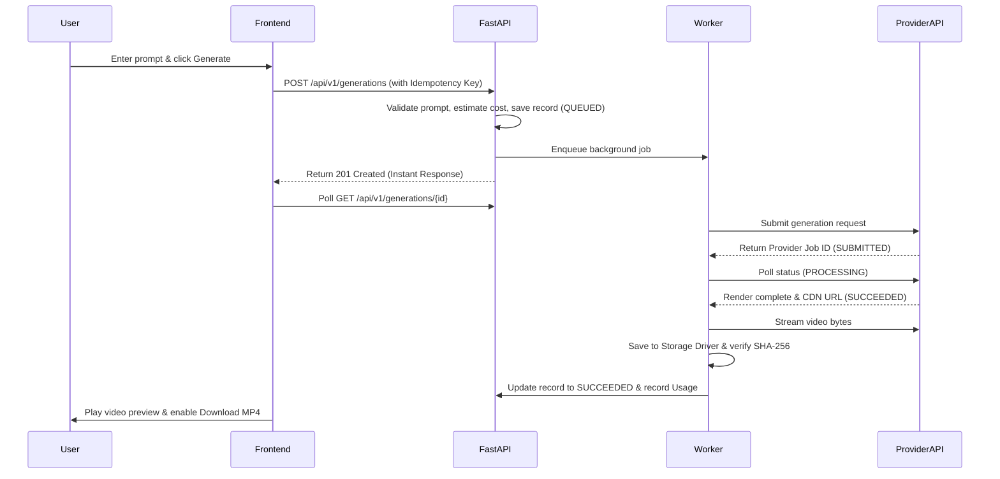

# CineForge AI — Master Academic Viva & Examination Guide
### Comprehensive M.Sc. IT Project Oral Examination Preparation

---

### Q1: What is CineForge AI and what primary problem does it solve?
**Answer:**  
CineForge AI is a full-stack, production-grade AI video generation and creative studio platform.  
Traditional generative video models are computationally heavy, take minutes to render, and their APIs often time out under ordinary HTTP connections. CineForge AI solves this by introducing:
1. An asynchronous background queue that decouples web requests from long-running inference jobs.
2. A provider adapter layer that unifies disparate AI models (Minimax, Kling, CogVideoX) under a single contract.
3. Bilingual prompt intelligence that decomposes ideas into cinematic director notes.
4. Transparent, second-by-second cost calculation preventing duplicate billing.

---

### Q2: How does a Diffusion Model generate video from text?
**Answer:**  
Video diffusion models extend 2D image latent diffusion models into 3D (Spatial + Temporal dimensions).
1. **Forward Process:** Gaussian noise is systematically added to video frames in latent space until pure noise remains.
2. **Reverse Process:** A neural network (often a 3D U-Net or Diffusion Transformer / DiT) is trained to iteratively predict and subtract the noise conditioned on a text embedding (produced via CLIP or T5 text encoders).
3. **Temporal Attention:** Cross-frame attention layers ensure character features and lighting remain consistent from frame $t$ to frame $t+1$.

---

### Q3: Why is FastAPI used instead of Flask or Django?
**Answer:**
1. **Native Asynchronous Support (`async`/`await`):** Essential for non-blocking I/O operations like database queries, external API streaming, and task scheduling.
2. **Automatic Data Validation:** Built on Pydantic v2, providing rigorous runtime type-checking and deserialization.
3. **OpenAPI Standards:** Automatically generates interactive Swagger documentation at `/docs`.

---

### Q4: Why is Next.js App Router chosen for the frontend?
**Answer:**
1. **Hybrid Rendering:** Combines fast Server-Side Rendering (SSR) for SEO-optimized marketing pages with responsive Client Components (`"use client"`) for the interactive studio workspace.
2. **Strict TypeScript Integration:** Eliminates frontend runtime type mismatches.
3. **Modern Monorepo Organization:** Co-locates API health routes, layouts, and route groups cleanly.

---

### Q5: How does the Asynchronous Generation Lifecycle work?
**Answer:**

---

### Q6: How is user data isolated in the multi-tenant architecture?
**Answer:**
Every authenticated request is decoded from a signed JWT bearer token containing `sub` (User UUID).  
All SQL queries in `ProjectService`, `GenerationService`, and `AssetService` enforce:
`WHERE owner_id == current_user.id`  
If a user tries to access another user's project ID, the service raises an `AccessForbiddenException` returning HTTP 403 Forbidden.

---

### Q7: What is the purpose of the Mock Video Provider?
**Answer:**  
In production, generating real AI video costs money per second ($0.03 to $0.08 per second).  
The `MockVideoProvider` allows automated unit tests, CI/CD pipelines, and local development to run with zero API costs while thoroughly verifying the full asynchronous state machine, parameter validation, and media storage drivers.
